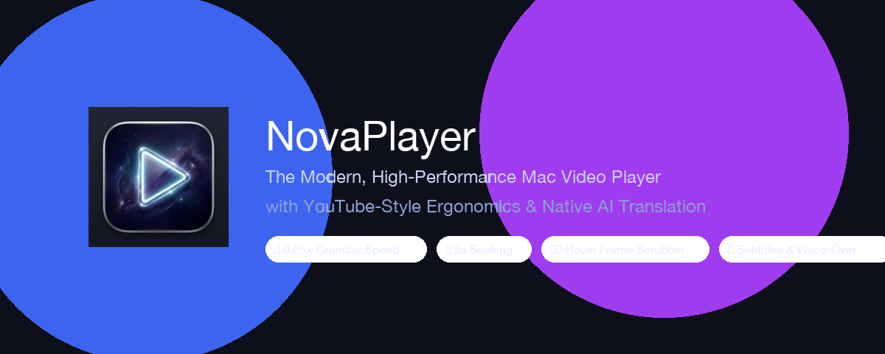
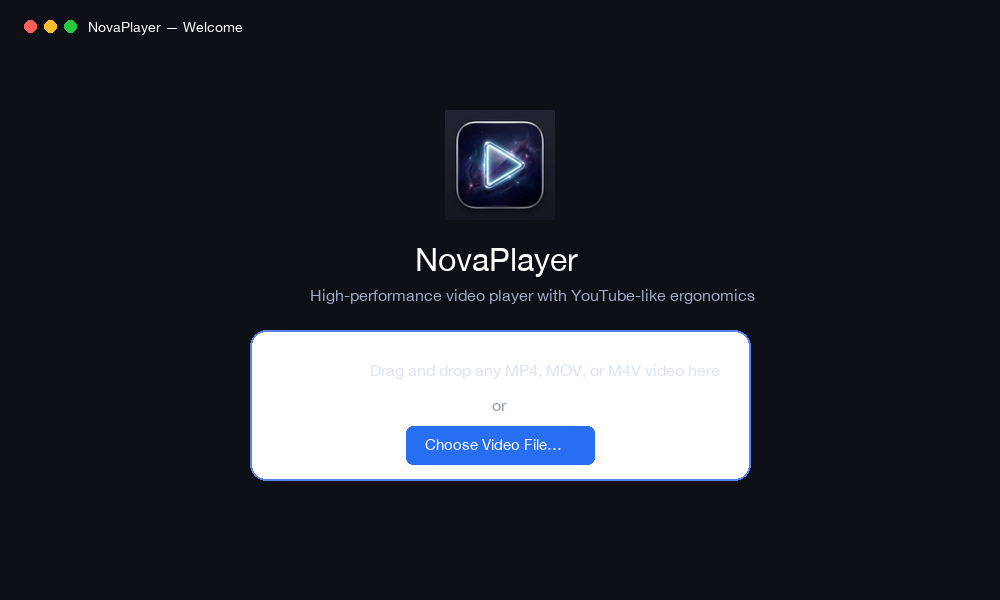
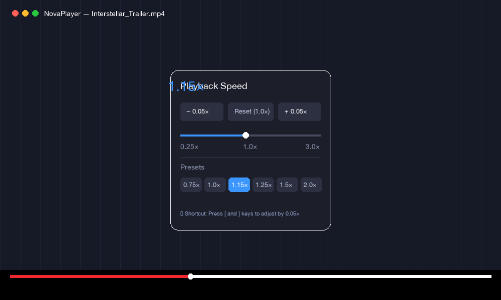
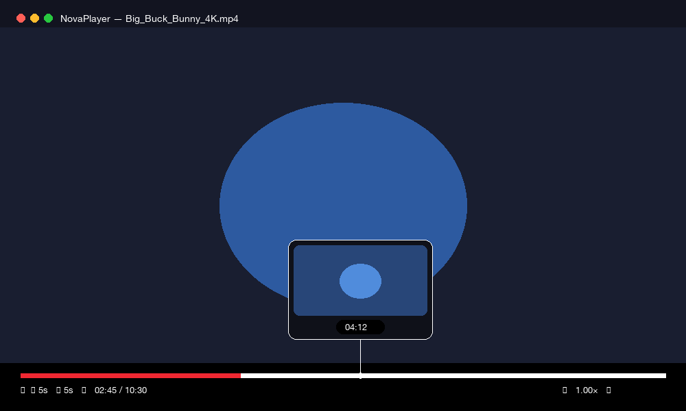
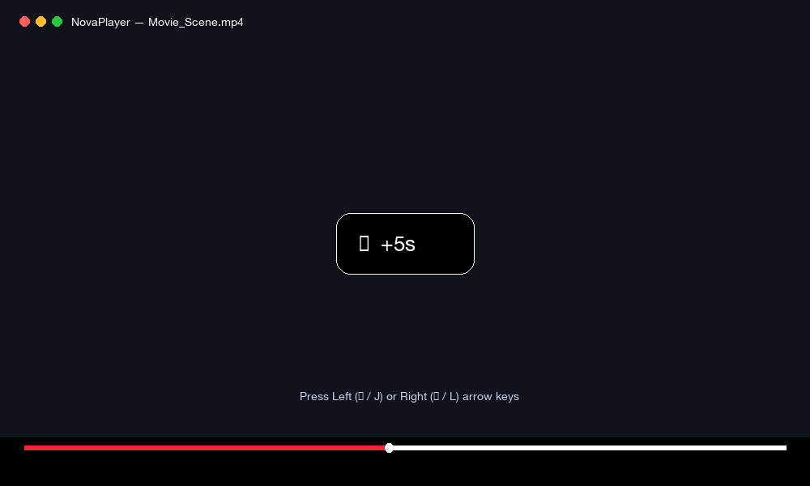
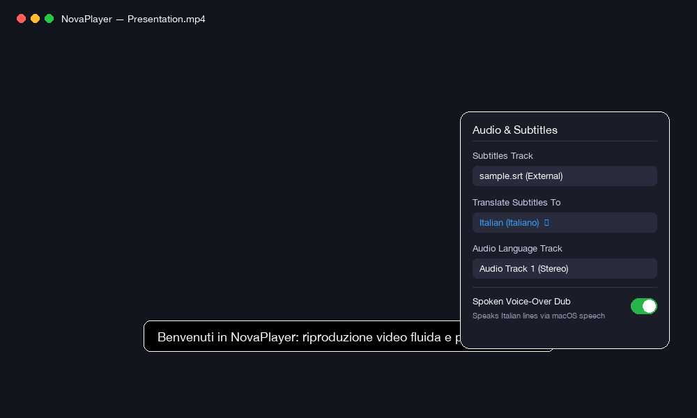
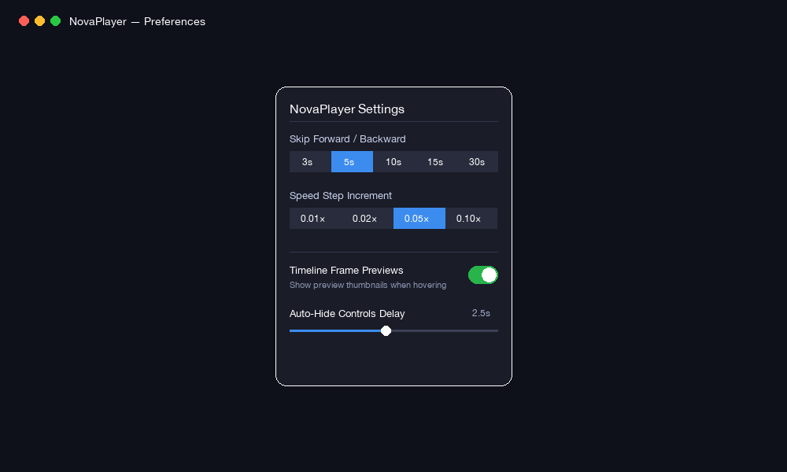

<p align="center">
  
</p>

<p align="center">
  <a href="https://github.com/Beccaceci/NovaPlayer/releases"></a>
  <a href="#"></a>
  <a href="#"></a>
  <a href="LICENSE"></a>
</p>

---

## 💡 About NovaPlayer

**NovaPlayer** is a modern, ultra-lightweight, high-performance native macOS media player built with **Swift 6, SwiftUI, and AVFoundation**.

QuickTime Player has remained virtually unchanged for over a decade: it lacks fine-grained playback speed controls, restricts frame scrubbing previews, and offers rigid, awkward seek intervals. **NovaPlayer brings the modern ergonomics of YouTube directly to native desktop video playback on Mac**, with Metal zero-copy hardware acceleration, minimal CPU consumption, and zero battery drain.

---

## ⚡ Key Highlights

* **🎛️ 0.05× Granular Playback Speed:** Fine-tune playback rate in increments of `0.05×` (e.g., `0.95×`, `1.00×`, `1.05×`, `1.10×`, `1.15×`) up to `4.00×`. Features built-in `timeDomain` pitch preservation so speech sounds completely natural without distortion.
* **🎞️ Timeline Frame Hover Preview:** Glide your cursor over the timeline scrubber to view a floating preview card showing the exact corresponding video frame and timestamp in real time.
* **⏩ 5-Second Seeking (YouTube-Style):** Skip forward or backward by 5 seconds with hotkeys (`←` / `→` or `J` / `L`), accompanied by transient animated center HUD notices (`+5s` / `-5s`).
* **💬 Subtitle Translation & Real-Time Spoken Voice-Over Dub:**
  * Detects embedded subtitles and automatically loads companion `.srt` / `.vtt` files.
  * Translates subtitles on the fly into **Italian**, **Spanish**, **French**, **German**, **English**, **Japanese**, **Chinese**, and **Portuguese**.
  * **Spoken Voice-Over:** Uses macOS's native `AVSpeechSynthesizer` to speak translated lines in real-time while automatically ducking the original soundtrack to 20% volume — *with zero heavy AI models required*.
* **🎬 Borderless Cinema Window & Dedicated Landing Page:**
  * Clean, distraction-free welcome screen with an interactive drag-and-drop zone.
  * Floating cinema player that smoothly fades out controls during playback and restores full macOS fullscreen with multi-monitor support.
* **⚡ Native Apple Silicon Acceleration:** Powered by `AVPlayer` and Metal hardware decoding for butter-smooth 4K 60fps playback.

---

## 🚀 Quick Install (One-Click)

### Option 1: Terminal One-Liner (Fastest)

Run this single command in your Terminal to automatically download, install to `/Applications`, and register NovaPlayer:

```bash
curl -fsSL https://raw.githubusercontent.com/Beccaceci/NovaPlayer/main/install.sh | bash
```

---

### Option 2: Download `.dmg` (Drag-and-Drop)

1. Download the latest **[NovaPlayer.dmg](https://github.com/Beccaceci/NovaPlayer/releases/latest)** from the Releases page.
2. Open the `.dmg` file.
3. Drag **NovaPlayer** into your **Applications** folder.
4. Launch it anytime via **Spotlight** (`Cmd + Space` -> `NovaPlayer`).

---

### Option 3: Build from Source

Requires macOS 14+ and Xcode Command Line Tools (`xcode-select --install`):

```bash
git clone https://github.com/Beccaceci/NovaPlayer.git
cd NovaPlayer
./scripts/build_app.sh
open build/NovaPlayer.app
```

---

## 📸 Feature Walkthrough

### 1. Dedicated Drag & Drop Landing Page
When launched without a video, NovaPlayer greets you with an intuitive, clean drag-and-drop landing area instead of an awkward blank player. Drag any `.mp4`, `.mov`, or `.m4v` video to immediately start playback.

<p align="center">
  
</p>

---

### 2. Fine-Grained 0.05× Playback Speed Dial
Adjust your playback speed with granular precision. Use `[` and `]` hotkeys on the fly, or click the speed badge to open the quick stepper, fluid slider, and preset chips (`0.75×`, `1.0×`, `1.15×`, `1.25×`, `1.5×`, `2.0×`).

<p align="center">
  
</p>

---

### 3. Timeline Scrubber with Live Hover Frame Previews
Move your mouse across the timeline without clicking to preview any scene. An asynchronous, debounced image generator paired with an LRU in-memory cache renders crisp 16:9 preview frames with zero stutter.

<p align="center">
  
</p>

---

### 4. 5-Second Seeking with Animated HUD Feedback
Never lose your place. Pressing `←` or `→` (or `J` / `L`) skips forward or backward by 5 seconds with an instant, YouTube-style animated badge in the center of the canvas.

<p align="center">
  
</p>

---

### 5. Subtitles & Real-Time Spoken Voice-Over Dubbing
Select from embedded audio and subtitle tracks or load external `.srt`/`.vtt` files. Turn on **Subtitle Translation** to translate text on the fly, and toggle **Spoken Voice-Over Dub** to have macOS vocalize the translated sentences in real-time while ducking the original audio.

<p align="center">
  
</p>

---

### 6. Customizable Preferences
Click the gear icon (`⚙️`) in the top bar to tailor NovaPlayer to your habits: adjust your preferred skip interval (`3s`, `5s`, `10s`, `15s`, `30s`), speed step (`0.01×`, `0.02×`, `0.05×`, `0.10×`), or auto-hide delay.

<p align="center">
  
</p>

---

## ⌨️ Keyboard Shortcuts Reference

NovaPlayer adopts standard YouTube hotkeys so you don't have to relearn any muscle memory:

| Key | Action |
| :--- | :--- |
| <kbd>Space</kbd> or <kbd>K</kbd> | Toggle Play / Pause |
| <kbd>←</kbd> or <kbd>J</kbd> | Skip Backward (default 5s) |
| <kbd>→</kbd> or <kbd>L</kbd> | Skip Forward (default 5s) |
| <kbd>[</kbd> | Decrease Playback Speed by 0.05× |
| <kbd>]</kbd> | Increase Playback Speed by 0.05× |
| <kbd>↑</kbd> / <kbd>↓</kbd> | Volume Up / Down (5%) |
| <kbd>M</kbd> | Toggle Mute |
| <kbd>F</kbd> | Toggle Fullscreen (or double-click video canvas) |
| <kbd>0</kbd> – <kbd>9</kbd> | Jump to 0% – 90% of total video duration |
| <kbd>Cmd</kbd> + <kbd>O</kbd> | Open Video File Dialog |
| <kbd>Cmd</kbd> + <kbd>W</kbd> | Close Window |

---

## ⚙️ Setting NovaPlayer as Your Default `.mp4` Player

1. In **Finder**, locate any `.mp4` video file.
2. **Right-click** (or Control-click) and select **Get Info** (<kbd>Cmd</kbd> + <kbd>I</kbd>).
3. Expand the **Open with:** section.
4. Select **NovaPlayer** from the dropdown menu.
5. Click **Change All…** and confirm.

Double-clicking any `.mp4` file will now launch directly in NovaPlayer!

---

## 🏗️ Architecture & Technology Stack

NovaPlayer is modularized into a clean MVVM + Service layer:

```
NovaPlayer/
├── Package.swift                    # Swift Package Manager Manifest
├── Sources/
│   ├── NovaPlayerKit/               # Core Framework Library
│   │   ├── Model/                   # PlayerState, AppSettings, SubtitleCue
│   │   ├── Services/                # PlaybackEngine, ThumbnailService, SubtitleManager, AudioVoiceoverEngine
│   │   ├── Views/                   # WelcomeLandingView, VideoSurfaceView, ControlsOverlayView, TimelineBarView
│   │   └── Controllers/             # KeyCommandHandler
│   └── NovaPlayer/
│       └── main.swift               # Application Entrypoint & Window Configuration
├── Tests/
│   └── NovaPlayerTests/             # 9 Automated Test Suites (100% pass)
└── scripts/
    ├── build_app.sh                 # Release bundle builder
    ├── package_dmg.sh               # Distributable DMG packager
    └── generate_docs_assets.py      # Retina documentation assets generator
```

---

## 🗺️ Roadmap & Cross-Platform Support

* [x] Native macOS AppKit + SwiftUI + AVFoundation engine
* [x] 0.05× Speed Granularity with pitch correction
* [x] 5-Second skipping with HUD animations
* [x] Live timeline hover frame thumbnails
* [x] Subtitle translation & native speech voice-over dubbing
* [x] Dedicated Drag & Drop Welcome page
* [ ] **Cross-Platform Release (Windows & Linux):** Multi-platform desktop port powered by **Tauri v2 + Rust + libmpv**.

---

## 📄 License

NovaPlayer is released under the **[MIT License](LICENSE)**. Contributions, bug reports, and feature requests are warmly welcomed!
